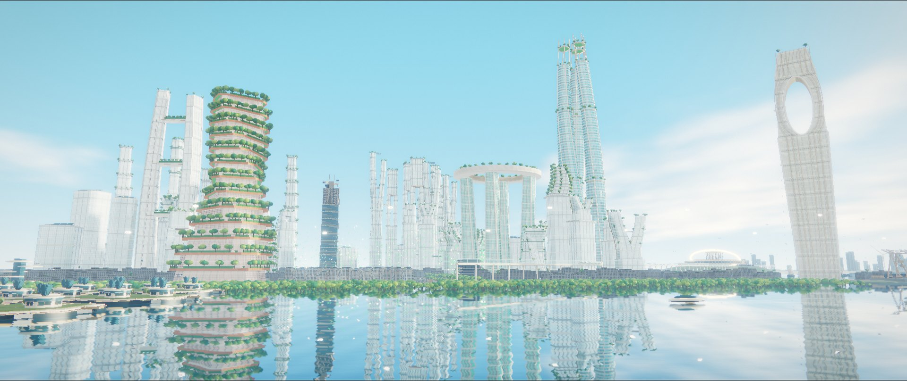
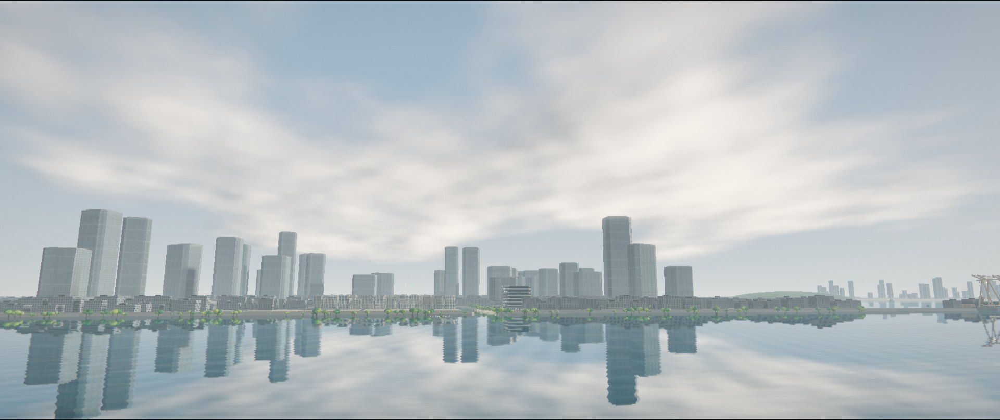
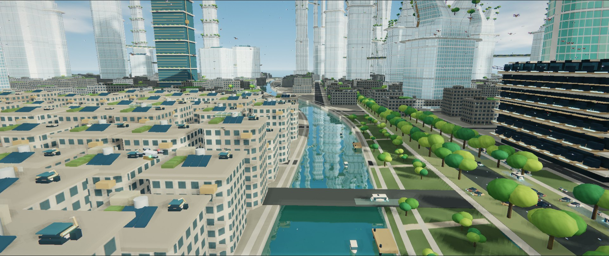
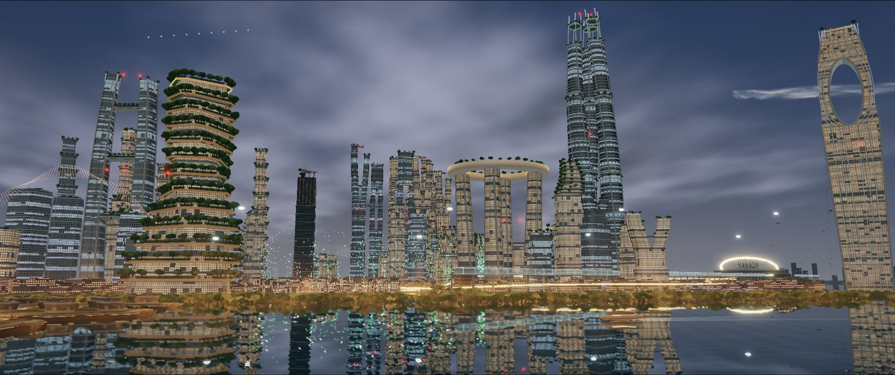

# Shenzhen 2046 · 深圳 2046

**What will Shenzhen look like twenty years from now?**
A 48-second film of the city in 2046, rendered live in your browser. Every building, wave, cloud, rocket and light is generated by code — no models, no textures, no images, no network requests.

**▶ Watch it:** https://earthsong.ai/shenzhen-2046/ (live on desktop, video on phones; tap "Sound on" for the score)



| | |
|---|---|
|  |  |
|  |  |
|  |  |

## The film

One continuous shot over Shenzhen Bay, from dawn to night:

1. **Twenty years** — the same view ages from 2026 to 2046. A fusion plant on the headland lights up, a wave of light runs across the city, and the skyline grows faster after it.
2. **The living coast** — mangroves and egrets are still here, and the sea wall has become a gentle, planted slope.
3. **Streets and the old village** — driverless shuttles, delivery drones landing on rooftop nests, a canal where roads used to be.
4. **The mirror world** — the city's digital twin drawn over the real one.
5. **A tower assembled room by room** — modular construction with a climbing crane.
6. **Above the clouds** — tower-top gardens and an airship.
7. **The bay** — the fusion plant, maglev along the shore, a cross-bay link, offshore wind, an undersea data centre.
8. **Launch and night** — a reusable rocket lands, another lifts off and flies out of Earth's shadow into sunlight, and the city lights up.

The future here is extrapolated from technology that exists today. It is an optimistic sketch, not a prediction.

## How it was made

- Built in about two hours with AI coding agents, directed and reviewed frame by frame by people.
- Pure [three.js](https://threejs.org) r180 (MIT), vendored in `vendor/`. No add-ons: post-processing, sky, water, shadows and camera are written from scratch.
- Every frame is a pure function of film time: `window.renderAt(t)` draws any second on its own, so the film can be rendered frame-exact.
- A global year `Y` (2026–2046) drives building heights, rooftops, traffic, shoreline and air clarity.
- HDR render target, bloom, ACES tone mapping, split toning, height fog and aerial perspective, planar water reflection, instanced crowds of towers, drones and trees, adaptive internal resolution.
- The approach was inspired by [Crimson Loong](https://github.com/ChetasLua/crimson-loong), a film made the same way. No code was taken from it.

## Sound

The film in this repository is silent. The version on earthsong.ai adds an instrumental score, which is not included here and is not covered by the MIT licence.

## Run it

Open `dist/shenzhen2046.html?auto=1` in a desktop browser with WebGL 2. Or build and serve it:

```sh
python3 tools/build.py      # src/*.js + vendor/three → dist/shenzhen2046.html
node tools/serve.mjs        # then open http://127.0.0.1:8080/?auto=1
```

Record the film frame by frame (needs Chrome, Node.js and ffmpeg):

```sh
node tools/record.mjs       # 1920×1080, 30 fps → out/shenzhen2046.mp4
```

In the console: `renderAt(29.5)` jumps to a second; `renderAt(0.5, 2046)` shows the opening view in 2046; `Film.T` is the beat sheet.

## Source map

| File | What it makes |
|---|---|
| `05_world.js` | Scene, anchors, the year `Y` |
| `15_detail.js` | Procedural detail maps |
| `20_sky.js` | Sky, sun, clouds, night sky |
| `30_towers.js`, `35_landmarks.js` | Tower generator, hero towers |
| `40_waterfront.js` – `46_blocks.js` | Coast, streets, the old village, city blocks |
| `49_air.js`, `55_flight.js` | Drones and air routes |
| `52_build.js` | The modular tower under construction |
| `54_energy.js` | Fusion plant, grid, wind, solar |
| `56_launch.js` | Rocket landing and launch |
| `57_cloud.js`, `58_islands.js` | Sea of clouds, floating district |
| `59_future.js` – `62_life.js` | Future details and life in the streets |
| `68_water.js` | Mirror water |
| `78_shadows.js`, `80_post.js` | Shadows and post-processing |
| `88_film.js` | Beat sheet, camera, time |
| `90_main.js` | Boot, render loop, adaptive quality |

## About

Made by [EarthSong](https://earthsong.ai) — a song for every place on Earth.

---

## 中文

**二十年后的深圳会是什么样？** 一部 48 秒、在浏览器里实时渲染的短片。楼、海、云、火箭和灯光全部由代码生成，没有模型、贴图、图片，也不联网。

**在线观看：** https://earthsong.ai/shenzhen-2046/ （电脑上实时渲染，手机上播放视频；点「开声音」听配乐。配乐不在本仓库，也不属于 MIT 授权范围）

一镜到底，从黎明到入夜：同一机位的二十年延时（聚变电站点亮）、活的海岸、街道与城中村、镜像世界、一间一间装起来的楼、云上的城、湾区、火箭回收与升空、2046 年的夜。片中的未来按今天已有的技术推演，是一份乐观的设想，不是预言。

用 AI 编程助手约两小时做成，由人逐帧看片、提意见返修。纯 three.js（MIT），所有效果自己写。方法上受《赤龍》（Crimson Loong）启发，没有使用它的任何代码。

代码以 MIT 协议开源，欢迎拿去改、拿去做你自己的城市。

## License

MIT — see [LICENSE](LICENSE). three.js is MIT-licensed by the three.js authors (`vendor/LICENSE`).
